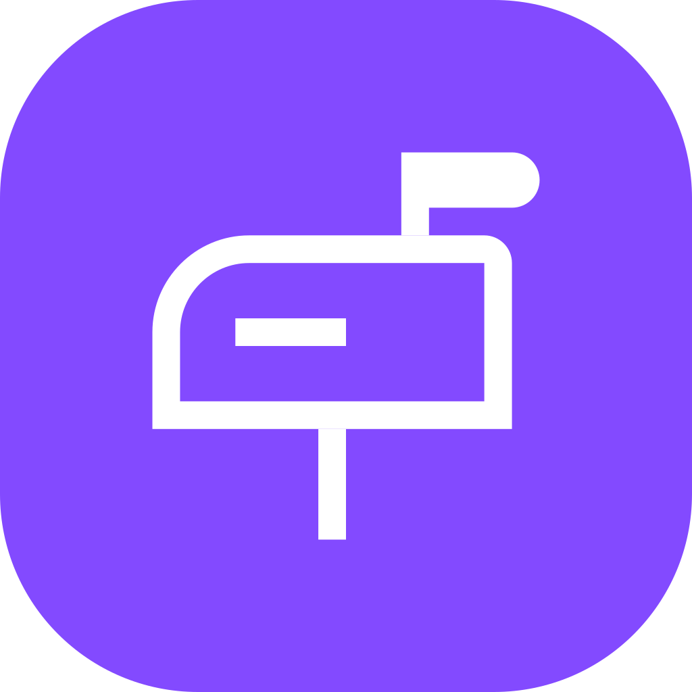
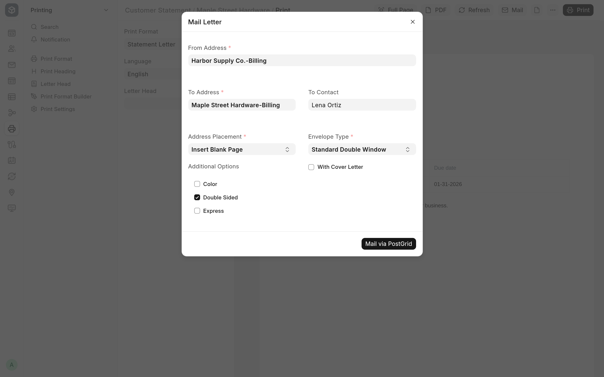

<!-- Copyright (c) 2026, Avunu LLC and contributors
For license information, please see license.txt-->

<!-- frappe-nix:begin header -->

<div align="center">



# Direct Mail via PostGrid

Direct mail for Frappe: send documents as physical letters via PostGrid

[](https://github.com/Avunu/postgrid_direct_mail/actions/workflows/ci.yml)
[](https://github.com/Avunu/postgrid_direct_mail/releases)
[](license.txt)
[](https://github.com/frappe/frappe/tree/version-16)

<picture>
  <source media="(prefers-color-scheme: dark)" srcset="docs/screenshots/mail-dialog-dark.webp">
  
</picture>

</div>

<!-- frappe-nix:end header -->

## Overview

Some customers and suppliers still need paper: invoices, statements, notices and purchase orders. Direct Mail via PostGrid mails the printed version of a Frappe or ERPNext document as a physical letter through [PostGrid's Print & Mail API](https://www.postgrid.com/ref/avunu), so nobody has to print, fold, stuff or stamp anything. PostGrid prints and posts the letter, and its delivery status comes back to the document's timeline.

Letters go to any Frappe **Address**, optionally to the attention of a **Contact**, so they work for customers, suppliers, employees and any other DocType that links to an address. You can send a letter by hand from the print view, or have a **Notification** mail one when a document is created, saved, submitted or cancelled, or a set number of days before or after a date.

## Features

- A **Mail** button on the print view of every submitted document. It mails the print format you are looking at, with the sender, recipient and contact filled in from the document's address and contact fields.
- An optional cover letter: pick a second print format of the same DocType and it is put in front of the document. With double-sided printing, a blank page keeps the document starting on a new sheet.
- Per-letter options: address placement (on a blank first page or at the top of the first page), envelope type (standard double window or flat), double-sided, colour and express.
- A **Mailed Letter** channel on Notifications, for mailing documents automatically on document events and on daily date-based events.
- Each letter in the document's timeline, with its recipient, its delivery status (Scheduled, Sending, Sent, Opened or Rejected) and a link to the letter in the PostGrid dashboard.
- Delivery status updates from PostGrid's webhooks, signed with a secret the app generates.
- Optionally, a copy of PostGrid's PDF saved on the letter's record, and addresses updated with PostGrid's verified version.
- Separate Test and Live API keys, with a switch between them.

<!-- frappe-nix:begin compatibility -->

## Compatibility

| Frappe | Branch       |
| ------ | ------------ |
| v16    | `version-16` |

<!-- frappe-nix:end compatibility -->

<!-- frappe-nix:begin installation -->

## Installation

On Frappe Cloud, install Direct Mail via PostGrid from the [Frappe marketplace](https://cloud.frappe.io/marketplace/apps/postgrid_direct_mail).

On a bench of your own:

```bash
bench get-app https://github.com/Avunu/postgrid_direct_mail --branch version-16
bench --site <site> install-app postgrid_direct_mail
```

<!-- frappe-nix:end installation -->

Until the first release creates the `version-16` branch, install from `develop` instead: `bench get-app https://github.com/Avunu/postgrid_direct_mail --branch develop`.

## Configuration

1. [Set up a PostGrid Print & Mail account](https://www.postgrid.com/ref/avunu) and [copy its API keys](https://dashboard.postgrid.com/dashboard/settings).
2. Open **PostGrid Settings** (also linked from the **Integrations** workspace, under **Direct Mail**).
3. Enter the Test and Live API keys, and choose the **Mode** that is in use.
4. Set the default options: **Address Placement**, **Envelope Type**, **Double Sided**, **Color** and **Express**. The Mail dialog starts from these.
5. Choose whether to **Save PDF Files** (keep PostGrid's PDF of each letter) and **Update Addresses** (overwrite an address with PostGrid's verified version).
6. Save. The first save in each mode registers a webhook with PostGrid for that mode, so the site must be reachable from the internet for delivery updates to arrive. **Reset Webhooks** in the form's actions replaces the webhook on both the Test and the Live account: it deletes the one the settings record, registers a new one and records its id. It needs both API keys, and changes nothing when one is missing.

To mail documents automatically, create a **Notification**, set its **Channel** to **Mailed Letter**, and fill in the **Direct Mail Settings** section: the **From Address**, the document's **To Address Field** and **To Contact Field**, the print format, the mailing options and an optional cover letter.

## How It Works

- The print page script (`page_js` for `print`) extends Frappe's print view with the **Mail** button and its dialog. The dialog's defaults come from the document's `company_address` (the sender), its `customer_address`, `shipping_address`, `billing_address`, `supplier_address` or `address` (the recipient, first one set), and its `contact_person`.
- `mail_letter` renders the print format, and the cover letter when there is one, to PDF, merges them with pypdf and sends the letter with PostGrid's Python client (`postgrid-python` 1.x). It records the request and PostGrid's response in an **Integration Request**, and on success adds a **Communication** of type **Mailed Letter** to the document, which the timeline shows through `additional_timeline_content`.
- PostGrid posts status changes to a guest endpoint as a JWT signed with the webhook secret. The app verifies it before reading anything, then updates the Integration Request and the Communication's delivery status.
- Mailed Letter notifications extend Frappe's own Notification controller (`extend_doctype_class`), so they run on Frappe's normal notification events and daily job; other channels are left to Frappe.
- On install and migrate the app adds **Mailed Letter** to the channel options of Notification and the type options of Communication, with property setters, and adds the custom fields it ships on Address and Notification. On install it also links PostGrid Settings from the Integrations workspace. Uninstalling removes all of these.

## Limitations

- Only letters are supported. Postcards and cheques are not implemented, although the webhook is registered for their events.
- The **Mail** button appears only on submitted (or cancelled) documents, so DocTypes that cannot be submitted can only be mailed by a Notification.
- A Mailed Letter notification mails on the New, Save, Submit, Cancel, Days Before and Days After events, and on a Method event for `after_insert`, `on_update`, `on_submit` or `on_cancel`. The Value Change, Minutes Before and Minutes After events don't mail.
- A notification's **To Contact Field** has no effect yet: the letter is addressed to the address alone, without the contact's name. Letters sent from the print view do include the contact.
- When a document has no `company_address`, the **From Address** in the Mail dialog stays empty and has to be picked by hand. With ERPNext installed, the dialog looks up the company's default address, but the answer arrives after the dialog is built and is not filled in.
- Delivery updates need the site to be reachable by PostGrid over the internet.

<!-- frappe-nix:begin support -->

## Support

- Bug reports and questions: [GitHub issues](https://github.com/Avunu/postgrid_direct_mail/issues)
- E-mail: <mail@avu.nu>

<!-- frappe-nix:end support -->

<!-- frappe-nix:begin development -->

## Development

```bash
nix develop        # or: direnv allow
prek install       # the git hooks CI runs
frappe-test        # the tests, the way CI runs them
```

The managed files, checks and release flow are described in the [app standards documentation](https://docs.avunu.net/frappe-nix/docs/app-standards/).

<!-- frappe-nix:end development -->

The source layout and the commands for working on the app are described in [docs/development.md](docs/development.md).

<!-- frappe-nix:begin license -->

## License

MIT, Copyright (c) 2024–present Avunu LLC → [license.txt](license.txt)

<!-- frappe-nix:end license -->
